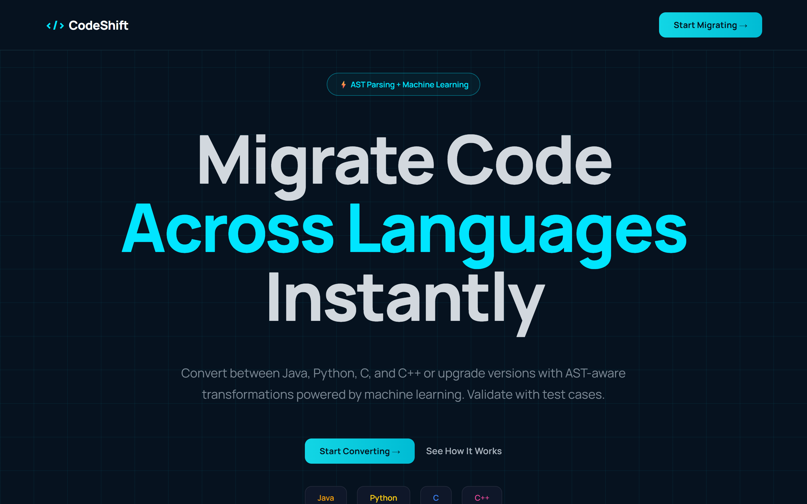
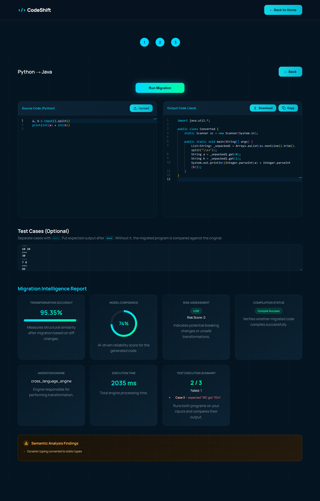
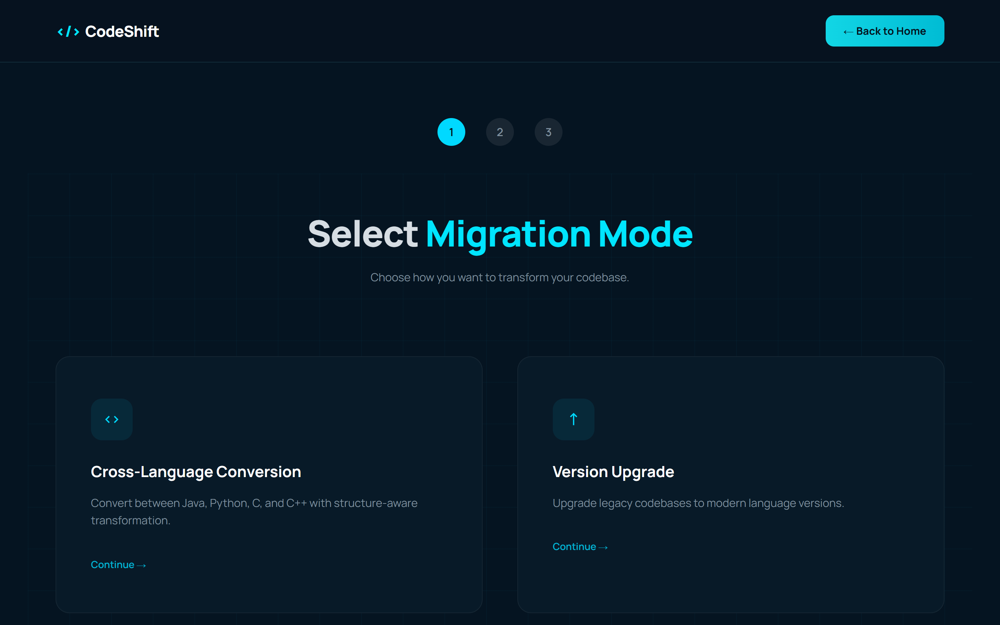
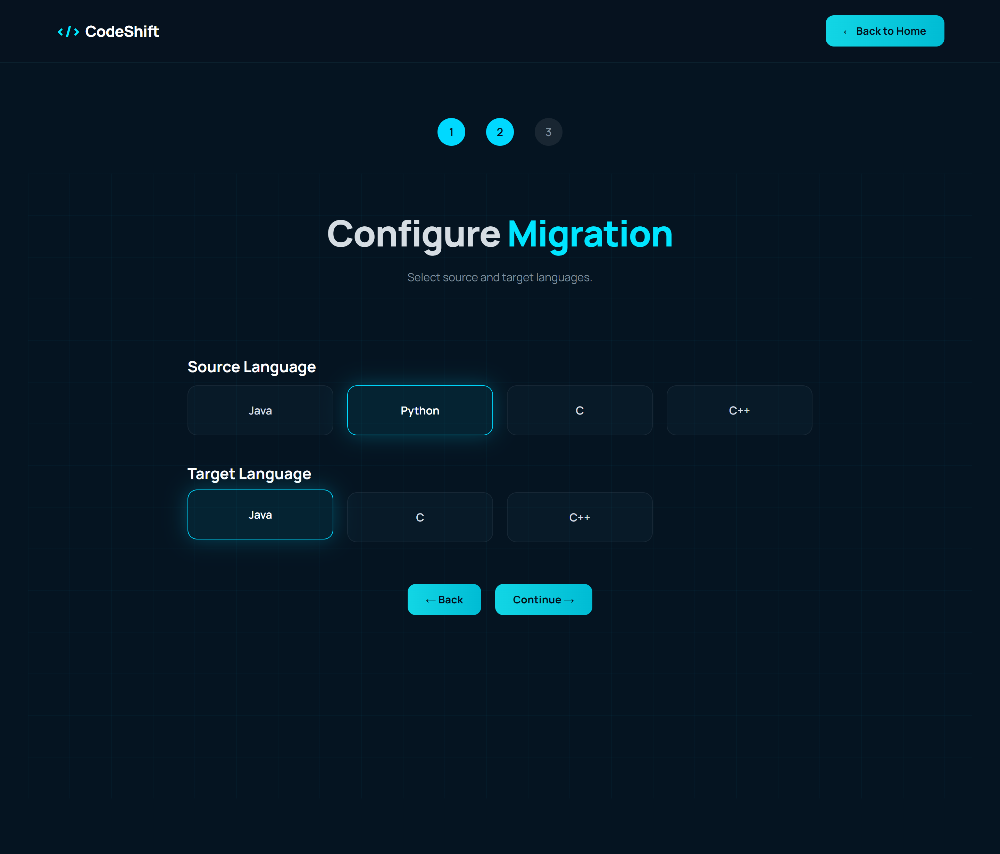
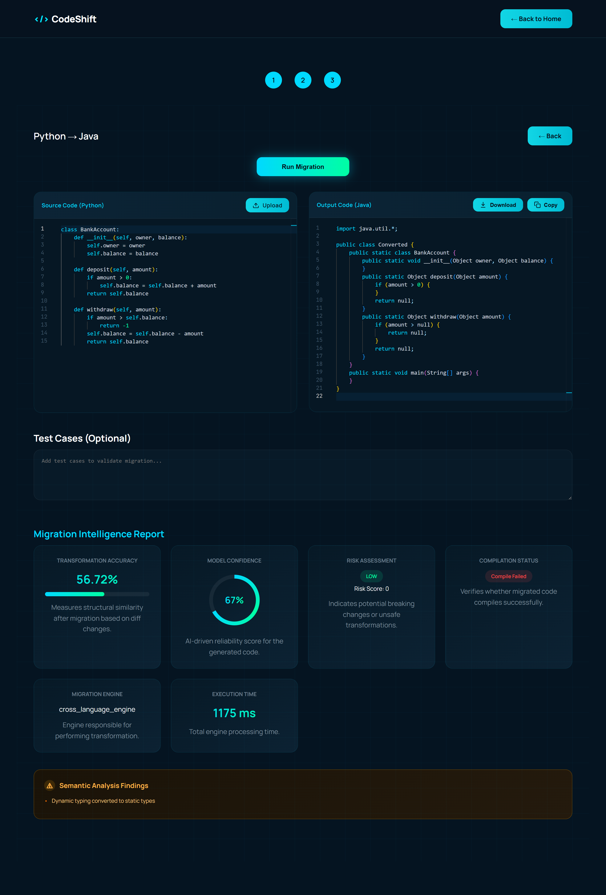
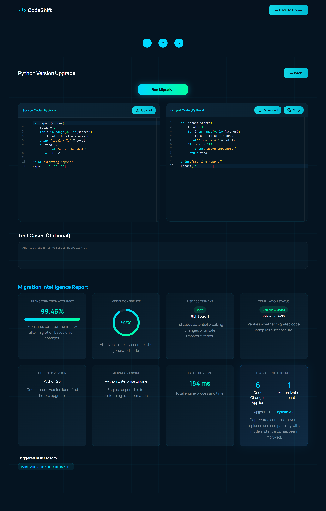
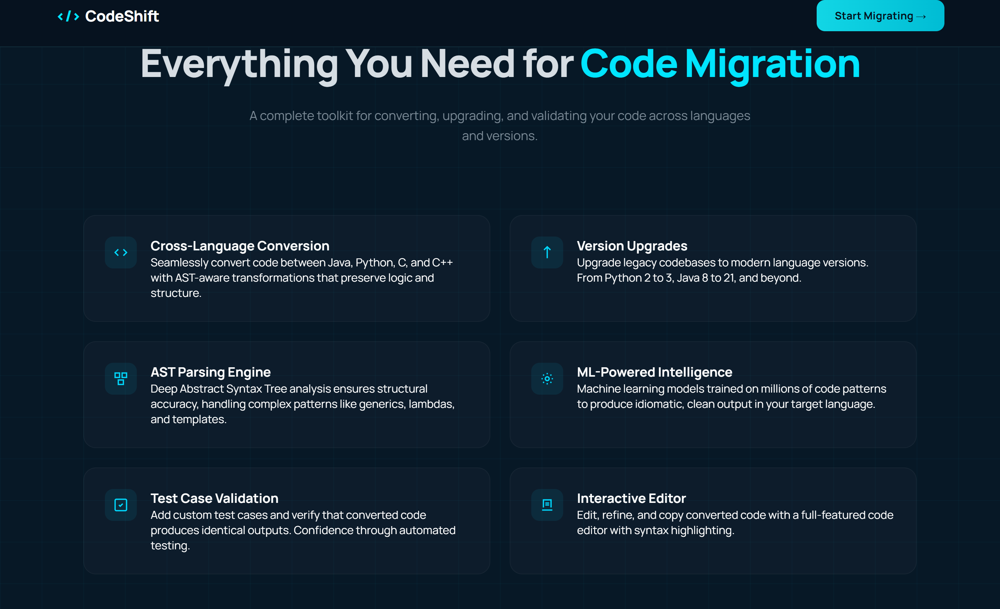

<div align="center">

# CodeShift

**Automated Code Migration System**

Convert code between Python, Java, C and C++ — or upgrade a legacy codebase to a modern
language version — then verify the result actually compiles and behaves the same.

[](https://github.com/thanmai-kolli/automated-code-migration-system/actions/workflows/ci.yml)

</div>



---

## What it does

| Engine | Does | Covers |
| --- | --- | --- |
| **Cross-Language** | Parses to a neutral IR, infers types across the whole program, regenerates | all 12 ordered pairs of Python, Java, C, C++ |
| **Version Upgrade** | Detects the version in use and applies rewrite rules, keeping each one only if the program still compiles (and passes your tests) | Python → 3.12, Java → 17, C → C17, C++ → C++20 |

Every run returns a **Migration Intelligence Report**: predicted accuracy and
confidence, risk triggers, real compiler output, semantic findings, token/AST/structure
similarity, a unified diff, and timing.

> The translation is **fully deterministic** — parse, lower to IR, type-annotate,
> re-emit. No LLM is involved, so the same input always gives the same output. Machine
> learning only *scores* a finished migration and auto-detects the source language.
> A construct that cannot be translated faithfully is **refused with an explanation**
> instead of being approximated.

---

## Architecture

```
codeshift-frontend/   React 19 + Vite + Monaco   →   3-step workspace
        │  POST /api/*  (proxied by Vite in dev)
        ▼
codeshift-backend/    Flask API
        ├── cross_language_system/   parse → IR → types → generate → validate → score
        └── version_upgrade_system/  detect → candidate rules → compile/test gate per rule → report
```

The **type annotator** is what makes statically typed targets work. Python and C carry
almost no type information syntactically, so a three-pass whole-program analysis
resolves every parameter, field, local and return type — from literals, from usage
(`amount > self.balance` ⇒ numeric, `total += s` ⇒ `s` is `total`'s type), from
call-site arguments, and by unifying constructor parameters with the fields they
initialise. Without it every signature degrades to `Object` and nothing compiles.

The type annotator also fixes the source language's arithmetic: integer `/` and `%`
truncate for C and Java sources and floor for Python sources, and implicit int/double
conversions become explicit casts, so every target computes the same numbers.

Parsers: Python via `ast`, Java via `javalang`, C/C++ via a recursive-descent parser.
C ↔ C++ also has a direct text rewriter, which round-trips those two exactly.

Both engines also run as interactive CLIs from `codeshift-backend/`:
`python -m cross_language_system.main_cross` and `python -m version_upgrade_system.main`.

---

## Quick start

**Prerequisites** — Python 3.10+, Node 18+. For compile validation: `javac`, `gcc`, `g++`.

```bash
# backend
cd codeshift-backend
python -m venv .venv && .venv\Scripts\activate
pip install -r requirements.txt
python flask_app.py                    # http://127.0.0.1:5000

# frontend, in a second terminal
cd codeshift-frontend
npm install && npm run dev             # http://localhost:5173
```

Vite proxies `/api` to Flask, so no CORS setup is needed.

<details>
<summary>Configuration</summary>

| Variable | Default | Purpose |
| --- | --- | --- |
| `HOST` / `PORT` | `127.0.0.1` / `5000` | bind address |
| `FLASK_DEBUG` | `0` | `1` enables auto-reload |
| `CORS_ORIGINS` | `localhost:5173,127.0.0.1:5173` | origins allowed without the Vite proxy |
| `CODESHIFT_ENABLE_TEST_EXECUTION` | `0` | `1` runs test cases — **executes submitted code locally** |
| `CODESHIFT_TEST_TIMEOUT` | `5` | per-run timeout, seconds |

Frontend overrides live in `codeshift-frontend/.env.example`.

</details>

---

## API

Both endpoints are `POST`, take JSON, and return `{ "success": true, "data": {...} }` or
`{ "success": false, "error": "..." }`. Bodies are capped at 1 MB. `GET /` is a health check.

```jsonc
// POST /api/cross-language
{ "code": "...", "source_language": "python", "target_language": "java",
  "test_cases": "2 3\n===\n5" }          // optional

// POST /api/version-upgrade
{ "code": "print 'hi'", "language": "python" }
```

`data` carries the generated `code` plus `accuracy`, `confidence`, `compile_success`,
`compile_errors`, `semantic_issues`, `risk_level`, `risk_triggers`, `diff_text`, the
three similarity scores, `timeTakenMs`, and `detected_version` for upgrades.

---

## Behavioural test validation

Compiling proves the output is valid; running it proves it is correct. Supply
`test_cases` and the engine runs **both** the original and the migration on the same
stdin and compares their stdout.

```
2 3
===
5
---
10 20
===
30
```

Cases split on `---`, input and expected output on `===`. The `===` half is optional —
without it the migration is compared against the original program, catching regressions
with nothing written by hand.

**No test cases? Characterization tests.** Legacy code rarely comes with tests, so for a
version upgrade without `test_cases` the engine writes its own: it builds the original
with its legacy standard (`gnu89`, `gnu++98`, JDK 17; Python 2 needs a `python2`
interpreter), runs it on generated inputs — or once, if it reads no input — and keeps
every input on which it terminates and prints the same output twice. Those outputs then
gate every rule, exactly like user tests. The report's `validation_basis` says what a
result was checked against: `compilation only`, your test cases, or the generated tests.



> **This executes submitted code.** It is off unless `CODESHIFT_ENABLE_TEST_EXECUTION=1`.
> Runs are capped at 5 s and 20 cases in a throwaway directory with a minimal
> environment — but that is **not** a sandbox. Local use only.

### Version-upgrade rules

Each rule is applied on its own and kept only if the program still compiles and
reproduces the reference outputs; rejected rules are listed in the report.

| Upgrade | Rewrites |
| --- | --- |
| Python 2 → 3 | `print`/`exec` statements, `except X, e`, `raise E, msg`, `<>`, backticks, `xrange`, `raw_input`, `iteritems`/`viewitems`, `has_key`, `basestring`/`unicode`/`long`/`unichr`, octal and `10L` literals, renamed modules (`ConfigParser`, `Queue`, `cPickle`, `urllib2`, `StringIO`, ...), `itertools.izip`, `sys.maxint`, `string.letters`, `os.getcwdu`, `file()`, `intern()`, `execfile()`, `apply()`, `sort(cmp=...)`, `reduce`, `__nonzero__`, iterator `next()`, stored dict views → `list()`, integer `/` → `//` where both operands are provably ints |
| Java ≤ 1.4 → 17 | boxing constructors → `valueOf`, `StringBuffer` → `StringBuilder`, anonymous functional classes → lambdas, local `Vector` → `List`, diamond `<>`, `close()` in `finally` → try-with-resources, `Iterator` loops → for-each, `instanceof` + cast → pattern matching |
| C89 → C17 | K&R definitions, implicit `int`, `void main`, missing prototypes, `f()` → `f(void)`, `gets`/`strcpy`/`strcat`/`sprintf` → bounded forms (array destinations), `malloc(sizeof)` → `calloc`, `bzero`/`bcopy`/`index`/`rindex` → `memset`/`memmove`/`strchr`/`strrchr` |
| C++98 → C++20 | `<iostream.h>` headers, `void main`, dynamic exception specifications, `NULL` → `nullptr`, `auto_ptr`, `register`, `typedef` → `using`, C casts → `static_cast`, iterator declarations → `auto`, `insert(make_pair)` → `emplace`, `throw()` → `noexcept`, `ptr_fun`/`not1`/`mem_fun`/`bind1st`/`bind2nd` → their C++11/17 replacements, `unary_function` bases, `random_shuffle` → `shuffle`, index loops → range-for, local owning `new` → `make_unique` |

---

## Scoring models

The scores are predicted by models fitted on **measured migrations**, not on
hand-written rules. `ml/build_dataset.py` translates every program of `ml/corpus.py` and
`ml/corpus_extra.json` into the other three languages, compiles and runs both sides on
the programs' inputs, and records what actually happened — **420 measured translations
of 58 programs** in `ml/migration_dataset.csv` (refused translations are excluded).

| Model | Predicts | Type |
| --- | --- | --- |
| `confidence_model.pkl` | `P(behaviour preserved)` | sigmoid-calibrated random forest on 25 features |
| `accuracy_model.pkl` | `behaviour_score`, shown as predicted accuracy | random forest regressor on 4 features |
| `language_model.pkl` | source language, when the caller omits it | TF-IDF + logistic regression |

`train_models.py` compares logistic regression, a random forest and a calibrated random
forest on all 25 features and on a 4-feature subset (compile status, library calls,
classes, collection operations) with grouped 5-fold CV — all rows for one program share a
fold — and deploys the lowest Brier score; for the accuracy it deploys the lowest MAE among
ridge and random-forest regressors and 100 × the probability. Results are written to
`ml/model_card.json`:

| grouped CV | deployed | compile status only | prior / mean |
| --- | --- | --- | --- |
| confidence — Brier score | 0.0215 | **0.0164** | 0.0498 |
| confidence — ROC AUC | **0.955** | 0.812 | n/a |
| accuracy — MAE (points) | 3.97 | **3.28** | 9.94 |

Only 7 of the 405 translations that compile misbehave, so the compile status alone
has the lowest error: the learned score adds ranking (AUC 0.86 among the compiled
translations, where the compile status cannot rank at all), not lower error.

```bash
cd codeshift-backend
set CODESHIFT_ENABLE_TEST_EXECUTION=1
python -m cross_language_system.ml.build_dataset      # compiles and runs everything
python -m cross_language_system.ml.train_models
python -m cross_language_system.ml.language_detector  # grouped CV, then saves the model
```

When test cases are supplied, the report shows the **measured** accuracy (share of passed
test cases) instead of the predicted one, next to the model's confidence.

---

## Screenshots

<table>
<tr>
<td width="50%"><br><sub><b>1.</b> Cross-language or version upgrade</sub></td>
<td width="50%"><br><sub><b>2.</b> Any source, any of the other three as target</sub></td>
</tr>
</table>



<details>
<summary>Version upgrade and landing page</summary>




</details>

---

## Tests

```bash
cd codeshift-backend  && pip install pytest && python -m pytest -q   # 280 tests
cd codeshift-frontend && npm run lint && npm run build
```

Covers the version detectors and the gated upgrade rules of all four languages, the AST
validator, diff and change counting, the language registry, similarity scoring, all API
routes including the payload limit, the test executor, the scoring models, the language
detector and their dataset, translation semantics (precedence, integer division, loops,
formatted I/O, input, classes and structs, refusals) and a compile check on all 12
pairs. Both suites run in CI on every push.

---

## Repository layout

```
codeshift-backend/
  flask_app.py                app factory + health route
  api/                        route blueprints
  tests/                      pytest suite
  cross_language_system/
    core/                     dispatcher, IR, type annotator, test executor, scoring
    parsers/ generators/ validators/     one module per language
    ml/                       corpus, dataset builder, training, models
  version_upgrade_system/
    core/                     gated rule engine, toolchain runner, comment/string masking
    languages/{python,java,c,cpp}/enterprise_engine/
                              per-language rules and version detector

codeshift-frontend/src/       pages, components, services, utils, styles
```

---

## Known limitations

Each program the engine cannot translate faithfully is **refused** with a reason
(`Cannot translate this program faithfully: ...`) rather than translated approximately.
On 194 programs written by independent authors for [Rosetta Code](https://rosettacode.org)
(582 translations, collected only after this version was frozen), 17.7% were translated
correctly, 60.5% were refused with an explanation and 0.7% (4) were silently wrong. On an
earlier set of 108 such programs, whose failures guided this version, 47.8% were correct.
The defects behind those four silent failures have since been fixed: the current engine
translates 18.6% of the 582 correctly and none silently wrong, with no regression on any
other benchmark (those programs are no longer unseen, so this is not a new held-out result).
Many of the newer tasks exist to demonstrate lambdas, closures and generators. The main gaps:

- **C as a target** has no growable list or string type: list growth, string building,
  string methods and iterating over a string from Python or Java, and C++ containers,
  `std::string`, classes and `<iomanip>`, are refused.
- **Refused C and C++ constructs:** pointer dereference, templates, `sizeof` other than
  an array length, chained assignment, writes into `char` arrays, function-like macros,
  the stream manipulators `scientific`, `setfill` and `boolalpha`, increments inside
  expressions and fall-through `switch` cases. The comma operator and several pointers
  declared in one statement are not parsed.
- **Refused Java and Python constructs:** lambdas, method references and anonymous
  classes, generators (`yield`), nested functions, argument unpacking, enums, labels,
  comprehensions in places Python evaluates conditionally (a `while` test, one branch of a
  conditional expression), slicing with a step other than -1, keyword arguments, and
  iterating a dictionary or set into C++ (`std::map` and `std::set` are ordered by key,
  Python's by insertion or hash).
- **Unmapped library calls** in Java or C++ output do not compile; C library calls with
  no mapping (`malloc`, `strcpy`, `qsort`, `rand`, ...) are refused for Python and Java
  targets. Java method overloading is not resolved for Python targets, and Python's
  `None` used as a missing integer is not modelled.
- **Numeric formats:** C/C++ `unsigned` arithmetic wraps around, Python's and Java's
  integers do not; Python integers become 64-bit where they grow through products,
  powers or additive recurrences (`a, b = b, a + b`, `ways[j] += ways[j - c]`) but
  overflow beyond 64 bits; Java's scientific notation for doubles of 10^7 and more
  (`1.0E7`) is reproduced in Python targets only.
- **C entry points and globals:** `main(argc, argv)` is translated when it ignores its
  arguments and refused when it reads them; C globals become module variables (with
  `global` declarations) in Python and static fields in Java.
- Where a Python type cannot be inferred, Java falls back to `Object`; each such decision
  is reported in the semantic findings.
- Single-file programs that use standard input and output only: no multi-file projects,
  concurrency or framework APIs.

**Library idioms with one defined meaning** (`core/library.py`): Python `round` (ties to
even) and `round(x, n)`, Java `Math.round`, C `round`; Python slicing, `s[::-1]`,
`sorted`, `reversed`, `str.join`, `str.isupper()` and friends, `enumerate`, `zip`,
`dict.items()` and `map(int, input().split())`; Java `StringBuilder`,
`Collections.reverse`, `Arrays.asList`; C++ `to_string`, `stoi`, `substr`, `reverse`,
`count`, `string::npos`, `fixed`, `setprecision` and `setw`. Python integers that grow
(products, powers) become 64-bit, and lists and floats print exactly as Python prints them.

**Handled by lowering rather than mapping** — counting loops become `range` only when
provably equivalent (otherwise a `while` loop), `switch` becomes an if/else chain,
`printf`/`%`/f-string formatting goes through one format-string node, comprehensions and
generator expressions become loops (`any`/`all` stop early), list and string repetition,
`divmod` and `print(*xs)` are expanded, tuple assignment goes through temporaries,
Python default arguments become Java overloads, `sizeof(a)/sizeof(a[0])` becomes the array
length, and identifiers the target reserves are renamed.

---

## License

[MIT](LICENSE)
